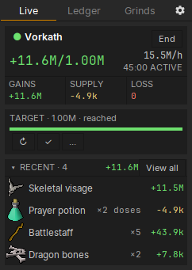
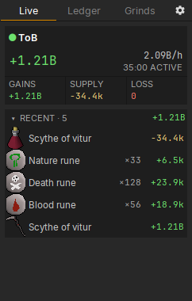
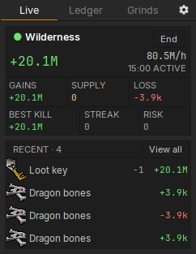
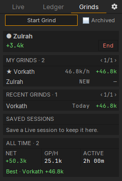
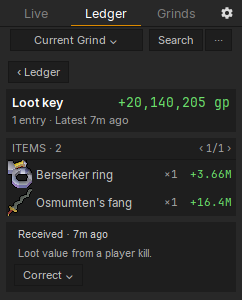
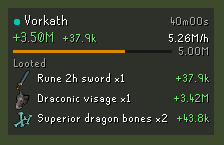
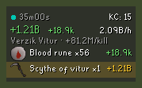

# GP Manager

See what you actually make while you play. GP Manager tracks your gains, supplies, losses and Grand Exchange trades for every trip and keeps a full ledger of where your GP went. You just play.

## Screenshots

| Live | Raid loot | PvP |
|:--:|:--:|:--:|
|  |  |  |
| Net, GP/h and your latest drops, with a target if you set one | A looted raid — the scythe is one entry | Kills, the victim's loot key, and what one is worth |

| Grinds | Loot key claim |
|:--:|:--:|
|  |  |
| Your Grinds with average GP/h, targets and All time | A key opens into one entry — the looted setup listed beneath it |

| HUD+ at a target | HUD+ on a raid streak |
|:--:|:--:|
|  |  |
| Net, GP/h, a target bar and the streak's loot | KC, Net per kill and the drop that made it |

## Features

- **Live** – your Net, GP/h, gains, supplies and losses as you play, plus your latest drops. Click the Net to set a GP or time target; click the ACTIVE clock to start fresh.
- **Ledger** – every gain, loss, trade and death, with the reason it counted. Open any row to see the items behind it, and fix anything from one Correct menu. Anything it wasn't sure about waits in Review for you.
- **Grinds** – start one by name (Vorkath, Zulrah, a skilling spot) and it's remembered with its targets, best run and average GP/h, so you can compare runs, including loot by the monster that dropped it. Between Grinds it tracks Free play on its own.
- **All time** – your total Net and GP/h and your best Grinds.
- **HUD+** – an optional box in the game window with your Net, GP/h and a loot tray for the current kill streak.
- **PvP** – kills, deaths and player loot in dangerous areas, plus what a death there would cost you.

## Getting started

1. Install **GP Manager** from the Plugin Hub.
2. Open it from its icon in the RuneLite sidebar.
3. Play. Tracking starts on its own; to name what you're doing, press **Grind** on the Live tab (or **Start Grind** on the Grinds tab).
4. New to it? **⚙ › Getting started** has a short guide.

Settings open from the wrench next to GP Manager in RuneLite's plugin list.

## What it counts

- **Supplies** you use: food, potions, runes, ammo, cannonballs and weapon charges (blowpipe, tridents, the Toxic staff of the dead, Bryophyta's staff, the Eye of Ayak and more). Picking up what you dropped or fired cancels it out.
- **Loot** once it reaches your inventory; keys, chests, caskets and clue rewards when you open them.
- **Grand Exchange** trades at the real tax. Banking, storage and gear swaps are neutral moves, not gains or losses.
- **Deaths**, reclaim fees and repair costs. Barrows gear wearing down is not a loss.
- **Prices** come from RuneLite's Grand Exchange prices or your own overrides; items with no Grand Exchange price count at their alch value, and ironmen can value items at high alch instead.
- **Separate worlds** – Leagues, Deadman, beta and tournament worlds pause tracking, so they never skew your regular GP/h.

If it isn't sure what happened, it doesn't guess: the entry waits in Review with a reason, and you decide.

## Your data

Everything stays on your computer, in one profile per account. The **⚙** menu backs up or resets your profile and shows where it's kept; to restore a backup, copy it over the profile file while RuneLite is closed. GP Manager makes no network calls of its own and never plays the game for you.

## Feedback

GP Manager is in beta, so I could use some help testing the flows I can't reach myself — the pinned [live-test checklist](https://github.com/xRampageous/gp-manager/issues/1) has them. Found a bug or have an idea? Use **⚙ › Report a bug**, open an [issue](https://github.com/xRampageous/gp-manager/issues), or ask in [Discussions](https://github.com/xRampageous/gp-manager/discussions). A screenshot of the Ledger entry helps a lot.
