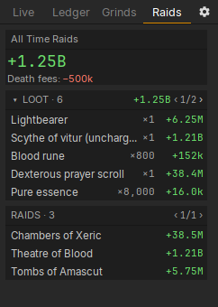

# GP Manager

See what you actually make while you play. GP Manager tracks your gains, supplies, losses and Grand Exchange trades for every trip, keeps recent receipts plus retained totals and records your raids. You just play.

Works on normal, Ironman and Hardcore Ironman accounts. Ultimate Ironman isn't supported.

## Screenshots

Illustrative sample data in the current UI.

| Live | Raids | PvP |
|:--:|:--:|:--:|
|  |  |  |
| Net, GP/h and your latest drops, with a target if you set one | Loot and death fees for each raid, plus All raids totals | Kills, deaths, the victim's loot key and what a death would risk |

| Grinds | Loot key claim |
|:--:|:--:|
|  |  |
| Your Grinds with average GP/h, targets and All time | A key opens into one entry — the looted setup listed beneath it |

| HUD+ at a target | HUD+ on a raid streak |
|:--:|:--:|
|  |  |
| Net, GP/h, a target bar and the streak's loot | KC, Net per kill and the drop that made it |

## Features

- **Live** – your Net, GP/h, gains, supplies and losses as you play, plus your latest drops. Click Net to set a GP or time target. Click the ACTIVE clock to restart GP/h or start a fresh session; your Free play or Grind keeps its whole total.
- **Ledger** – recent gains, losses, trades and deaths, with the reason they counted. Open an entry to see its retained receipts. Older details are compacted; totals remain. Anything GP Manager wasn't sure about waits in Review for you, and **Correct › Exclude** takes an entry out of your totals (you can undo it).
- **Grinds** – start one by name (Vorkath, Zulrah, a skilling spot). It remembers your targets, best run and average GP/h, so you can compare runs, including loot by the monster that dropped it.
- **Free play** – everything you make outside Grinds, with an optional milestone (say 1B). **⚙ › Reset free-play** starts it over and keeps the old run under Grinds › FREE PLAY, where you can restore it.
- **Raids** – entering Chambers of Xeric, Theatre of Blood, Tombs of Amascut or The Fractured Archive unlocks this account's Raids tab, including logging in mid-raid. Your recorded attempts stay available after restarting, even if you died or failed. Open the tab manually to see loot, death fees and All raids totals. With RuneLite's Loot Tracker on, unclaimed rewards show as a pending preview; loot counts once, when you take or bank it.
- **PvP** – kills, deaths, your best kill and streak in dangerous areas, plus estimated Risk. Stored charges, including bracelet ether and the new Fractured Archive items' contents, aren't in Risk. Click KILLS for retained PK loot this Grind, or DEATHS for losses and fees; BEST is a read-only best-kill figure. Choose **Always** under Loot display to see these stats anywhere.
- **Saved sessions** – **⚙ › View recap** shows the session so far; **Save session** keeps a copy in Grinds without stopping your clock or changing your totals. Rename it or copy a summary from its row menu.
- **All time** – your total Net and GP/h and your best Grinds.
- **HUD+** – an optional box in the game window with your Net, GP/h and a loot tray for the current kill streak. **Compact item rows** shows each item as an icon with a short value and quantity, such as **200M ×1**.

## Getting started

1. Install **GP Manager** from the Plugin Hub.
2. Open it from its icon in the RuneLite sidebar.
3. Play. Tracking starts on its own; to name what you're doing, press **Start Grind** on the Grinds tab.
4. New to it? **⚙ › Getting started** has a short guide.

Settings open from the wrench next to GP Manager in RuneLite's plugin list.

## What it counts

- **Supplies** you use: food, potions, runes, ammo, cannonballs and weapon charges (blowpipe, tridents, the Toxic staff of the dead, Bryophyta's staff, the Eye of Ayak, the Obligator, Zorya's tome and more). Picking up what you dropped or fired cancels it out.
- **Loot** once collected into your inventory or bank. Opening a chest, key, casket or clue reward preview doesn't count its contents.
- **Grand Exchange** trades at the real tax, including partly filled offers and trades above max cash paid in platinum tokens. Offers placed on another device count when you collect them here. Banking, storage and gear swaps are neutral moves, not gains or losses.
- **Deaths**, reclaim fees and repair costs. Items you get back from a gravestone stay neutral, and Barrows gear wearing down is not a loss.
- **Prices** come from RuneLite's Grand Exchange prices or your own overrides; items with no Grand Exchange price count at their alch value, and ironmen can value items at high alch instead.
- **Separate worlds** – Leagues, Deadman, beta and tournament worlds pause tracking, so they never skew your regular GP/h.

If it isn't sure what happened, it doesn't guess: the entry waits in Review with a reason, and you decide.

## Your data

Everything stays on your computer, in one profile per account. The **⚙** menu backs up your profile, shows where it's kept and has **Delete Profile** (with or without a backup first); to restore a backup, copy it over the profile file while RuneLite is closed. Very large histories can make saving slower; a future update will compact older runs. Keep a backup. GP Manager makes no network calls of its own and never plays the game for you.

## Feedback

GP Manager is in beta. Found a bug or have an idea? Use **⚙ › Report a bug**, open an [issue](https://github.com/xRampageous/gp-manager/issues), or ask in [Discussions](https://github.com/xRampageous/gp-manager/discussions). A screenshot of the Ledger entry helps a lot.
